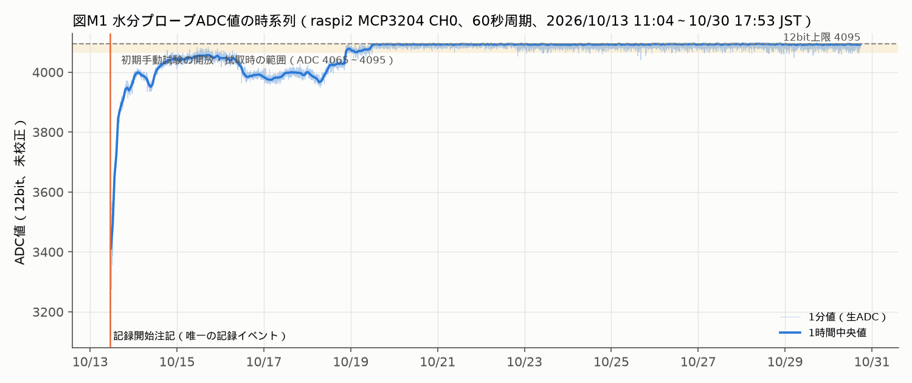
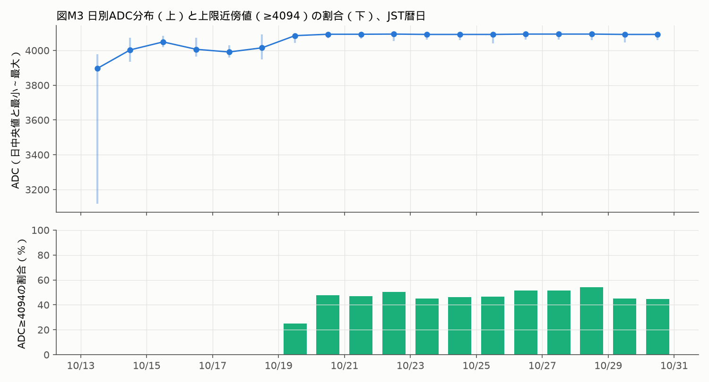
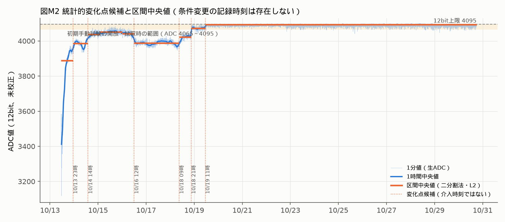
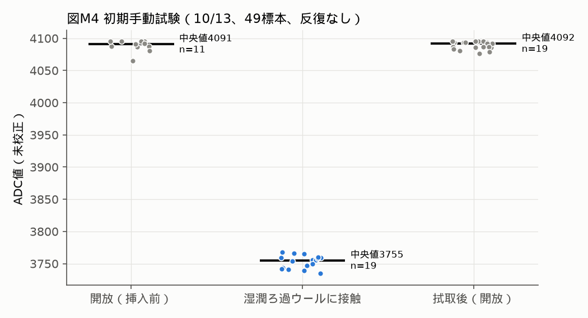

# 水分保持・給水実験（ADC連続計測）の監査結果

監査日：2026-10-30。時刻はすべてJST（UTC+09:00）。SQLiteは `observed_at_utc`（UTC、ミリ秒）をJSTへ変換して集計した。
データ：raspi2 `/home/pi/plant-iot-moisture/readings.sqlite3` を `mode=ro`・`PRAGMA query_only=ON`・単一読み取りトランザクションで抽出した固定スナップショット（抽出時刻 **2026-10-30 17:53:26 JST**、`data/adc_snapshot_raw.csv`、SHA-256 `8238911a…5ba1a27`）。実験は継続中で、ロガーは停止していない。本書の数値はこの時刻までに限定する。

> **結論（要約）**
> 1. 計測系の連続性は確認できた。60秒周期で17日6時間48分、**期待24,889件に対し24,889件（欠測0、NULL 0、最大間隔60.005秒）**。
> 2. ADC値は初日に3,118から約3,950へ上昇し、10/14〜10/18は3,950〜4,080付近で推移した。**10/19以降はADC上限付近（中央値4,093、4,094以上が48.07%）に張り付いた。** 張り付き水準は、初期手動試験でプローブを開放（空気中）したときの値（中央値4,091〜4,092）と区別できない。
> 3. **フェルト紐4本／1本、無補水、給水条件変更の日時は、調査したどの記録にも存在しない。** 記録済みイベントは開始時の注記1件だけである。したがって**条件別比較・条件変更前後の変化率は算出できない**。
> 4. 統計的な変化点候補と、1分以内に生じた段差（10/16 11:40頃の低下、10/18 21:02頃の上昇）は検出できた。ただし、これらを介入時刻や条件の効果とは扱わない。
> 5. ADC値は校正されていない電気信号である。本書では含水率（%）への換算を一切していない。

## 1. 実ファイルとスキーマ

|項目|確認結果|
|---|---|
|ファイル|`readings.sqlite3`（WAL稼働中。本体3,248,128 B、WAL 4,140,632 B、10/30 17:46時点）|
|ロガー|`moisture_logger.py run --interval 60`、user service `plant-iot-moisture-logger.service`：active/running、起動は10/13 11:04:57|
|ハードウェア（README）|MCP3204 CH0、SPI0/CE0、100 kHz、mode 0、12 bit（0〜4095）。公称3.3 V、10 kΩ分圧、2電極抵抗式プローブ。**電極には直流が常時印加される**|
|`adc_readings`|id, observed_at_utc, device_id, spi_bus, spi_device, adc_channel, adc_raw, adc_voltage_estimate_v（公称VREFによる推定）, vref_assumed_v, quality_flag（ok / near_max（≥4094）/ error）, error, phase（既定 `unclassified`）|
|`observation_events`|id, noted_at_utc, note。**1件のみ**：10/13 11:04:28.735「計測開始。ロガー起動時点の物理的挿入状態・支持体状態は未確認。値は未校正ADC」|
|phase列|全24,890行が `unclassified`。条件ラベルは付与されていない|
|クラウド送信|なし（ローカルのみ）|

出典：`analysis/export_sqlite_snapshot.py`、raspi2の `README.md`・`moisture_logger.py`・systemd user unit。

## 2. 実験期間・周期・件数・欠測率

|指標|値|
|---|---|
|全行|24,890行（10/13 11:04:28.594〜10/30 17:53:00.548）|
|id=1|サービス起動28.8秒前の手動1標本（ADC 3,415）。連続区間から除外|
|連続区間|10/13 11:04:57.426〜10/30 17:53:00.548、**24,889行**|
|期待件数|連続区間の最初の時刻を起点とする60秒格子で、各行を最も近い格子点（±30秒）へ割当。期待24,889枠|
|充足／欠測|24,889枠すべてに1行（重複0、欠測0）＝**取得率100%、欠測率0%**|
|NULL・エラー|adc_raw NULL 0件、quality_flag=error 0件|
|間隔|最小60.000秒、中央値60.000秒、最大60.005秒、90秒超0件。累積ドリフト＋3.12秒（暦日件数が1,439件の日がある原因）|

先行監査（10/19までの9,416/9,416件、24時間窓1,440/1,440件、ADC 3,118〜4,012）は、本スナップショットでも同じ値を再現した。

## 3. ADC値の記述統計

|範囲|n|最小|最大|平均|中央値|標本SD|4,094以上|=4,095|
|---|---:|---:|---:|---:|---:|---:|---:|---:|
|連続区間全体|24,889|3,118|4,095|4,059.73|4,088|66.85|31.40%|24.73%|
|全行（id=1を含む）|24,890|3,118|4,095|4,059.70|4,088|66.97|31.40%|24.72%|

日別（JST暦日）の統計は `results/moisture_daily.csv`、1時間中央値は `results/moisture_hourly.csv` に収録した。

|日|件数|最小|中央値|最大|平均|SD|≥4094|
|---|---:|---:|---:|---:|---:|---:|---:|
|10/13（途中開始）|777|3,118|3,896|3,979|3,811.58|181.56|0%|
|10/14|1,440|3,934|4,003|4,074|4,005.98|29.87|0%|
|10/15|1,440|4,020|4,049|4,083|4,050.14|9.14|0%|
|10/16|1,440|3,964|4,006.5|4,072|4,014.52|27.22|0%|
|10/17|1,440|3,959|3,991|4,030|3,989.33|11.32|0%|
|10/18|1,440|3,947|4,015|4,092|4,012.75|31.85|0%|
|10/19|1,440|4,043|4,085|4,095|4,082.44|11.14|25.07%|
|10/20〜10/29（各日）|1,439〜1,440|4,041〜4,070|4,092〜4,094|4,095|4,090.3〜4,091.7|3.9〜6.2|44.9〜54.1%|
|10/30（17:53まで）|1,074|4,059|4,092|4,095|4,090.29|6.22|44.79%|

## 4. 経時変化（図M1〜M3）

1. **初期上昇（10/13 11:04〜23時）**：最小3,118（11:31）から1時間中央値で約3,950へ上昇した。最初の1時間は隣接差が±90〜157と大きく、変動が大きい。挿入直後の接触・なじみ、支持体の水分変化、電極の分極が考えられるが、区別する記録はない。
2. **中間帯（10/14〜10/18）**：中央値は3,986〜4,051の間で段階的に変化した。10/14〜18の時刻別平均には約30カウントの日周変動がある（7〜9時に低く、21〜23時に高い）。温度の影響を示唆するが、現在は温度センサーが稼働していないため検証できない（`QUANTITATIVE_RESULTS.md` §4）。
3. **上限付近の張り付き（10/19 11時〜）**：271時間にわたり中央値4,093、SD 5.29、4,094以上が48.07%。日周変動はほぼ消えた（時刻別平均の幅は約1.2カウント）。

**ADC値の向きについて。** 初期手動試験（§7）では、湿ったろ過ウールに接触させると中央値3,755、開放時は4,091、拭き取り後は4,092だった。この配線では、**ADC値が高いほど電極間の導通が小さい**ことと整合する。ただし10/19以降の値は「開放時」と同じ範囲にある。そのため次の可能性を区別できない。

- 支持体の乾燥
- 電極と支持体の接触喪失
- 直流印加による分極・腐食
- 無補水条件への移行

**12 bit上限による計測レンジの飽和**であり、これ以上の乾燥を区別できない状態である。

## 5. 変化点候補・区間比較・安定期間

方法：連続区間の1時間中央値（415点）を対象に、L2コストの二分割法（最小区間12時間、ペナルティ＝2σ²log n、σは差分のMADから推定）を用いた。図M2の縦線はこの方法で得た統計的候補で、介入時刻ではない。

|区間（JST、1時間単位）|時間|n|中央値|平均|SD|≥4094|中央値の前区間比|
|---|---:|---:|---:|---:|---:|---:|---:|
|10/13 11時〜23時|12|716|3,887.5|3,799.48|182.99|0%|—|
|10/13 23時〜10/14 14時|15|900|3,986|3,983.15|19.01|0%|+98.5（+2.53%）|
|10/14 14時〜10/15 02時|12|720|4,038|4,036.79|10.89|0%|+52（+1.30%）|
|10/15 02時〜10/16 00時|22|1,320|4,051|4,050.95|8.80|0%|+13（+0.32%）|
|10/16 00時〜12時|12|720|4,042|4,039.23|14.19|0%|−9（−0.22%）|
|10/16 12時〜10/18 09時|45|2,700|3,988|3,988.13|11.07|0%|−54（−1.34%）|
|10/18 09時〜21時|12|720|4,023|4,019.75|14.04|0%|+35（+0.88%）|
|10/18 21時〜10/19 11時|14|840|4,073|4,072.84|7.55|0.36%|+50（+1.24%）|
|10/19 11時〜10/30 17:53|271|16,253|4,093|4,091.06|5.29|48.07%|+20（+0.49%）|

変化率は生ADCカウントの比である。分圧回路の出力は導電率に対して非線形であり、含水率の変化率としては解釈できない。上の3区間（10/15 02時、10/16 00時の境界など）は分割利得が小さく（<1,000）、強い候補ではない。利得5,000以上の主要候補は、10/13 23時、10/14 14時、10/16 12時、10/18 09時、10/18 21時、10/19 11時である。

**1分以内に生じた段差（候補時刻）**：漸進的な変化とは異なり、離散的な物理事象（接触変化、操作、給水など）と整合する。条件変更記録と照合する最優先の時刻として示す。

|時刻（JST）|直前10分|直後10分|変化|
|---|---|---|---|
|2026-10-16 11:40|4,007〜4,035|3,964〜3,990|約−45〜−50で以後持続|
|2026-10-18 21:02|4,019〜4,036|4,052〜4,064|約＋30で以後持続し、上限付近へ移行|

**比較的安定していた期間**（24時間移動窓のSD最小）：

- 非飽和で最も安定：**10/15 05:00からの24時間**（中央値4,051、SD 8.63）
- 長い非飽和区間：**10/16 12時〜10/18 09時の45時間**（中央値3,988、SD 11.07）
- 10/19以降の窓（SD 3.7〜5.1）は、上限での張り付きによる「見かけの安定」であり、保持状態が安定していた証拠にはならない。

## 6. 人為的介入と測定値の対応

|調査した記録|結果|
|---|---|
|SQLite `observation_events`|開始注記1件のみ|
|SQLite `phase` 列|全件 `unclassified`|
|raspi2・raspi1のホーム配下（`.git`・ブラウザプロファイルを除く）で「フェルト／felt／紐／4本／1本／無補水／wick」を全文検索|10月の条件変更記録なし。ヒットは9月以前の構想文書のみ|
|Supabase `care_logs`|最終記録9/9 15:41。10月の記録なし|
|ローカルSlack収集DB（909件）|10月の給水・フェルト関連の投稿なし|
|raspi2の過去ツール実行ログ（〜10/26）|10/26にも同じ検索が行われ、該当なし|

**結論：フェルト紐4本／1本、無補水、給水条件変更が、いつ・どの順で行われたかを示す記録は確認できなかった。** このため、測定値と介入の対応付け、条件別比較グラフ、条件変更前後の変化率は作成しなかった。「比較可能な場合のみ」という条件を満たさないためである。条件比較の図として作成したのは、記録の残る初期手動試験（図M4）だけである。

**追加検証の方法**：実験ノート、スマートフォン写真のEXIF時刻、LINEやメッセージの送信時刻から条件変更時刻を復元する。そのうえで `moisture_logger.py event "<条件>"` 形式で事後注記し、本書の候補時刻（10/16 11:40、10/18 21:02、10/19 11時頃）と照合する。事後注記であることは本文に明記する。

## 7. 初期手動試験（別実験、図M4）

|条件|n|中央値|範囲|
|---|---:|---:|---|
|開放（挿入前）|11|4,091|4,065〜4,095|
|湿潤ろ過ウールに接触|19|3,755|3,735〜3,768|
|拭き取り後（開放）|19|4,092|4,076〜4,095|

時刻は概算で、各条件は1回のみ（反復なし）。連続記録とは合算しない。「湿潤媒体との接触で読み値が約340カウント下がる」という電気的応答の予備的確認にとどまる。

## 8. 言えること・言えないこと

**言えること**
- 低コストのADC計測系で、60秒周期・17日超・欠測0の連続ローカル記録を実現した。
- 開始直後の約12時間に、ADC値が3,118から約3,950まで大きく変化した。
- 10/19以降、読み値は開放時と同じ上限付近に張り付き、プローブの検出レンジを外れた。
- 1分以内の段差が少なくとも2回あり、何らかの離散事象と整合する。

**言えないこと**
- 含水率（%）や水分保持量：校正していない。重量法などの基準測定もない。
- フェルト本数、給水方式、無補水の効果：条件の時刻が記録されていない。条件ごとの反復（n）もない。同時に温度・設置状態などが変化した可能性も排除できない。
- 10/19以降の張り付きの原因：乾燥、接触喪失、電極劣化を区別する観測がない。
- 植物の水分状態や生育への効果：植物は現在栽培されていない（9/8の文書）。

**次の実験に必要な最小条件**：①条件変更ごとにイベントを即時記録する。②重量法で校正する（支持体の質量を同時に測る）。③間欠励起で電極の分極を抑える。④温度を同時に記録する。⑤条件ごとに反復するか、フェルト本数ごとに並列プローブを置く。⑥飽和しない分圧抵抗を選び直す。
