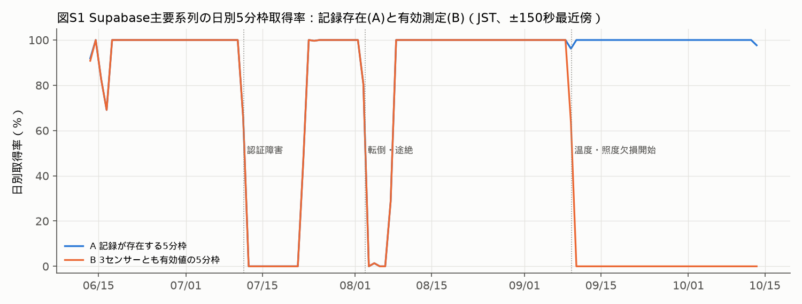
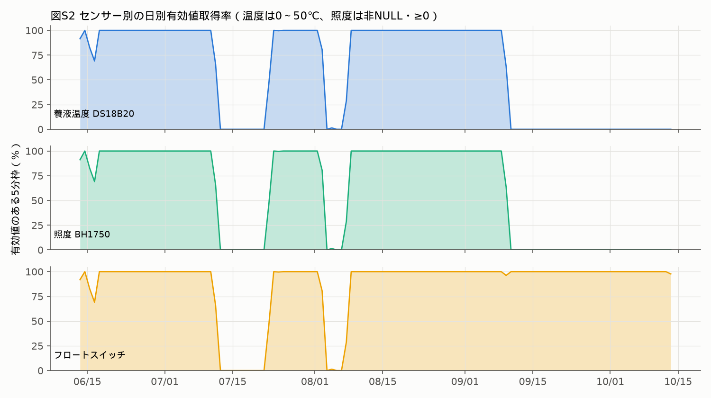
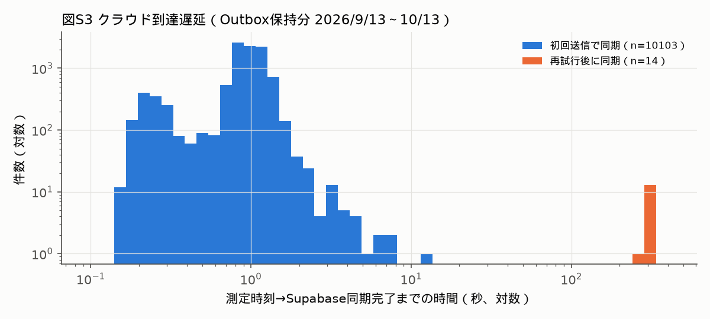

# 定量評価結果（Supabase運用評価・システム実用性）

監査日：2026-10-30。時刻はJST（UTC+09:00、夏時間なし）。日と月の境界もJSTで区切った。

**データ取得経路**：Supabase `oawkrkgnjkldfyvjcrgx` に対し、raspi2の既存設定（`.env`）にあるキーを使い、PostgREST経由で**GETのみ**を実行した。全行を取得した時刻は10/30 17:55。キーは表示・保存していない（`analysis/supabase_rest_export.py`）。取得件数 `sensor_logs` 43,280／`care_logs` 29／`plant_observations` 7件は、`Content-Range` の総数と一致した。Outboxはraspi2の `data.db` を読み取り専用で開き、時刻列だけを抽出した（`analysis/export_outbox.py`）。

## 0. A・B・Cの定義

|区分|意味|本書での測り方|
|---|---|---|
|**A 記録存在**|期待5分枠に1行以上ある|主要系列（device=`raspberrypi2` かつ source=`raspberrypi2-ds18b20-bh1750-float`）の `created_at` を最近傍の5分枠に割り当てる。割当式は `300·floor((t+150)/300)`、許容窓は[−150, +150)秒。1枠に複数行あっても1枠と数える|
|**B 有効測定**|その枠に、必要なセンサー値が有効な行がある|養液温度：非NULLかつ0〜50 ℃（85.0 ℃の4件を除外）。照度：非NULLかつ0以上。フロート：`water_ok`/`low_water`。3項目とも有効な枠を「3センサー有効」とする|
|**C クラウド到達**|測定からSupabaseに同期されるまでの時間|`created_at` は**端末側の測定時刻**であり、DBへの挿入時刻列はない。そのためCは、Outboxの `synced_at − 測定時刻` でのみ測れる。Outboxは30日保持のため、測定できるのは9/13〜10/13だけである|

期待枠：半開区間[A, B)のうち、A ≦ s < B を満たす5分境界の時刻s。「端点を含む」区間は、B＝終端＋5分として表した。Bの「有効」は値域と型の検査に過ぎず、センサーの校正や物理的妥当性を保証しない。

## 1. 記録件数（A）

|月|主要系列の行数|温度NULL率|照度NULL率|フロートNULL率|5分枠A|5分枠B（3センサー）|
|---|---:|---:|---:|---:|---:|---:|
|2026-06（6/13 01:20〜）|5,502|0.02%|0.05%|0%|96.88%|96.83%|
|2026-07|6,569|0%|0%|0%|64.90%|64.90%|
|2026-08|8,991|0%|0%|0%|84.22%|84.22%|
|2026-09|10,171|70.73%|70.73%|0%|99.87%|**28.78%**|
|2026-10（〜10/13 10:40）|4,174|100%|100%|0%|99.92%|**0.00%**|
|計|**35,407**|32.11%|32.12%|0%|86.61%|59.02%|

- 主要系列は、6/13 01:22:21から10/13 10:35:00までの35,407行。先行監査値と一致した。
- 日別：対象123日のうち、Aが99%以上の日は100日、Aが0%の日は13日。B（3センサー有効）が99%以上の日は67日。全日のデータは `results/supabase_daily_coverage.csv`。
- 行の間隔：中央値299.52秒、60秒未満4,861、600秒超10。行数が枠数より多いのは、起動時・手動・イベントによる追加行があるためである。行数をそのまま取得率の分子にしない。

## 2. 期間別の取得率（A対B）

|区間（JST）|期待枠|A 記録枠|A率|B 3センサー有効枠|B率|
|---|---:|---:|---:|---:|---:|
|全記録範囲[6/13 01:20, 10/13 10:40)|35,248|30,530|86.61%|20,804|59.02%|
|指定区間[7/22 00:00, 8/2 19:15)|3,399|3,244|95.44%|3,244|95.44%|
|復旧後区間 7/22 13:05〜8/2 19:15（端点含む）|3,243|3,240|**99.91%**|3,240|99.91%|
|P1 設置〜認証障害前[6/13 01:20, 7/11 15:45)|8,237|8,076|98.05%|8,073|98.01%|
|P2 認証障害期[7/11 15:45, 7/22 13:05)|3,136|5|0.16%|5|0.16%|
|P3 復旧後〜転倒前|3,243|3,240|99.91%|3,240|99.91%|
|P4 転倒後〜記録再開[8/2 19:20, 8/7 17:05)|1,413|4|0.28%|4|0.28%|
|**P5 再開〜欠損前[8/7 17:05, 9/9 15:10)**|**9,481**|**9,481**|**100.00%**|**9,481**|**100.00%**|
|**P6 欠損後[9/9 15:10, 10/13 10:40)**|**9,738**|**9,724**|**99.86%**|**1**|**0.01%**|

**新たに確認したこと**

- **P5（8/7〜9/9、32.9日）は、9,481枠すべてでA・Bとも100%だった。** 先行監査で使われていた99.91%区間（約11日）よりも長い、欠測のない連続区間である。ただし8/2の転倒事故後であり、9/8の文書には「現在は植物を栽培していない」とある。この区間は計測系の稼働実績であり、栽培評価には使えない。
- **P6では、記録は99.86%存在したが、有効な温度・照度は0.01%（1枠）しかない。** 「記録が届いていること」と「測定できていること」が最も大きく食い違った区間である。

センサー別の有効枠（全記録範囲）：温度20,806、照度20,805、フロート30,530。

## 3. 最長空白・障害前後

|順位|空白（隣接行間）|長さ|対応する事象（証拠水準）|
|---:|---|---:|---|
|1|7/11 15:40:00 → 7/22 12:39:07|**260.99時間（10日21時間）**|Supabase 401認証障害（作業記録B）|
|2|8/4 10:49:59 → 8/7 17:02:43|78.21時間|転倒後の一時再開とその後の停止|
|3|8/2 19:16:39 → 8/4 10:35:15|39.31時間|8/2 19:16の多項目急変の直後（転倒・電源脱落は家族の発見記録B）|
|4|6/15 19:45:00 → 6/16 07:26:00|11.68時間|設置初期|
|5|6/13 04:35:01 → 06:30:47|1.93時間|設置当日|
|6〜7|9/9 15:10:56 → 15:42:06、15:44:05 → 16:13:07|0.52時間、0.48時間|**9/9の欠損発生時（§4）**|

## 4. 9/9以降の温度・照度NULLの原因調査

|証拠|内容|水準|
|---|---|---|
|最後の非NULL|温度・照度とも **9/9 15:09:59**（id 31915）。値は温度27.625 ℃、照度35.8 lx で、異常値ではない|A|
|直後の行|15:10:56（id 31916）に両方NULL・`low_water`・vitality 0。その後、15:42:06、15:44:05、16:13:07、16:14:59と不規則な間隔で行が続く。周期外の行は、送信プロセスの起動時測定と整合する|A（行）、C（再起動の推定）|
|フロート|15:42以降は `water_ok`。`care_logs` には15:41:26に「low_water→water_ok回復」の自動記録がある。同じ時間帯に水位も変化しており、現地で作業が行われたことと整合する|A（記録）、C（作業内容）|
|故障モード|1-Wire（DS18B20）とI²C（BH1750）という**異なるバスの2センサーが同じ1分以内に同時に失われ**、以後回復しなかった。一方、GPIOのフロートは継続した。単体のセンサー故障より、共通の配線・コネクタ・電源の切断や、センサーの取り外しと整合する|C（推論）|
|現在の状態（10/30）|1-Wireバス上にDS18B20（ファミリーコード28）は存在せず、ファミリー0の不明デバイス2件（未接続バスに典型的な応答）のみ。旧送信サービスは停止している|A（現在の状態のみ）|
|ソフトウェア|`read_optional` は FileNotFoundError / OSError / ValueError をNoneに変換して送信を続ける（`send_sensor_raspberrypi2.py:92–97`）。ソースコードの変更履歴は9/9前後になく、最終の実装コミットは7/22|A|

**結論**：原因は**確定できない**。ソフトウェア変更が原因ではなく、9/9 15:10頃の現地作業と同時に、両センサーの物理的な接続が失われたと考えるのが最も整合的である。ただし作業内容の記録はない（証拠水準C）。

**設計上の新しい知見（A）**：P6の11,368行のうち11,367行は **vitality=100、「安定しています」** と記録された。`vitality.py` は、欠けた入力を減点せずに読み飛ばすためである。センサーが失われると健康指標が最高値になり、障害を隠す動きをした。センサーの欠落は通知条件にもなっていなかった。

## 5. C：クラウドへの到達（Outbox、9/13 10:35〜10/13 10:35）

|指標|値|
|---|---|
|Outbox行数|10,117（全件synced、pending・failedは0）|
|測定→同期完了|最小0.149秒、**中央値0.924秒**、p95 1.365秒、p99 1.791秒、最大295.8秒|
|10秒以内／60秒以内／300秒以内|10,102（99.85%）／10,103（99.86%）／10,117（100%）|
|再試行後に同期|14件（0.14%）。いずれも次の周期で同期し、遅延は282〜296秒|
|**重複**|同じ範囲のSupabase行は10,118件で、Outboxより1件多い。**10/2 05:29:59.032954の測定がSupabaseに2行（id 39518・39519）ある。** 対応するOutbox行（id 18983）は retry_count=1、last_errorあり。**初回POSTはDBに書き込まれていたが、端末側では失敗と判定され、再送で重複した**ことを示す実例である|

**解釈**：9/13〜10/13の期間は、ほぼ準リアルタイム（中央値1秒未満）でクラウドに到達していた。ただしこの期間はP6にあたり、**到達していたのは温度・照度がNULLの行**である。Cが良くてもBが良いとは限らない。9/13より前の到達遅延は、Outboxが残っていないため測定できない。7月の11日間の空白は「遅れて到達した」のではなく、記録そのものがない（この障害の前はOutboxが未導入だった）。

## 6. デバイス・センサー構成の履歴（`sensor_logs` の系列）

|device_id / source|行数|期間（JST）|構成|
|---|---:|---|---|
|NULL / sensor|2,767|4/26〜5/25|初期構成（pressure列あり）|
|NULL / dht11-mcp3204|2,683|6/2〜6/11|DHT11・MCP3204|
|NULL / dht11-ds18b20-mcp3208|283|6/12〜6/13|DS18B20を追加|
|raspi / raspi-dht11-ds18b20-mcp3208|2,139|6/13〜6/20|1号機（屋内・動作確認用）|
|**raspberrypi2 / …-ds18b20-bh1750-float**|**35,407**|**6/13〜10/13**|**2号機主要系列（屋外・ベランダ）**|
|raspberrypi2 / sensor|1|7/22 12:51|復旧時の単発行|
|（ローカル）raspi2 ADC|24,890|10/13〜10/30（継続中）|MCP3204 CH0 水分プローブ（クラウド送信なし）|

## 7. システム実用性（実装・稼働・評価の区別）

|機能|実装|実稼働の証拠|評価実績|
|---|---|---|---|
|Web可視化（GitHub Pages）|あり（`docs/index.html`）|公開URLへのGETがHTTP 200（10/30）|描画・利用の評価はない。HTMLが配信されることと機能全体の正常性は別|
|LINE・Slack通知|あり（低水位・回復・送信障害）|`care_logs` に回復の自動記録7件（6/15〜9/9）|経路別の送信・到達記録がなく、成功率・遅延は算出できない。LINE・Slackは片方の成功で共通状態を更新する（OR成功）|
|利用者の応答|LINEの受信・応答処理なし。Slackは写真投稿で起動|写真起点の `care_logs` 19件（6/16〜7/15）|応答時間や行動変容の記録はない|
|AI観察記録|あり（Gemini/OpenAI）|`plant_observations` 7件（gemini-3.5-flash 5件、gemini-3.1-flash-lite 2件）|正解ラベルや精度の評価はない。登録の遅れは0〜351.7時間で、2件はbackfill|
|センサーとの関連付け|あり（±10分の最近傍）|7件中5件（71.4%）に `sensor_log_id`|関連付けの正しさは未評価|
|障害復旧処理|Outbox（ローカル保存・次の周期で再送）、送信失敗3回で通知|再試行後に同期14件、全件synced。**再送による重複1件**|7月障害のときは未導入。冪等キーがないため、重複防止はできない|
|センサー欠落の検知|**なし**（送信処理はNoneを読み飛ばす。`supabase_health_check.py` は最新レコードの鮮度・CPU温度・メモリを検査するが、値のNULLは検査しない。timerも非稼働）|P6で33日間、温度・照度が欠落したまま通知されなかった|—|

AI・通知の実装の詳細は、先行監査 `../THESIS_BOT_FUNCTION_AUDIT_20261030.md` を参照。今回、Slack・LINEへのテスト送信は行っていない。
